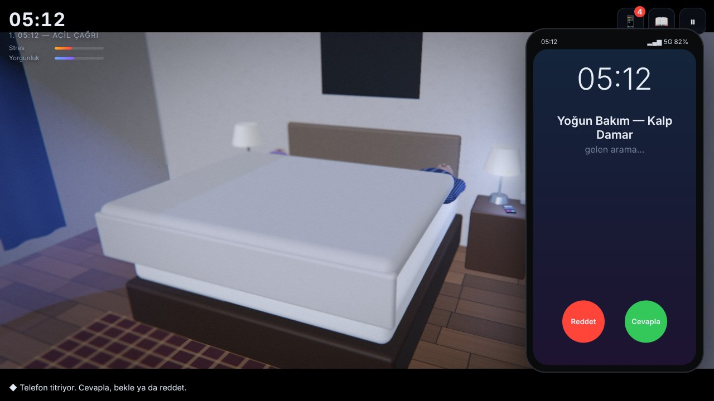
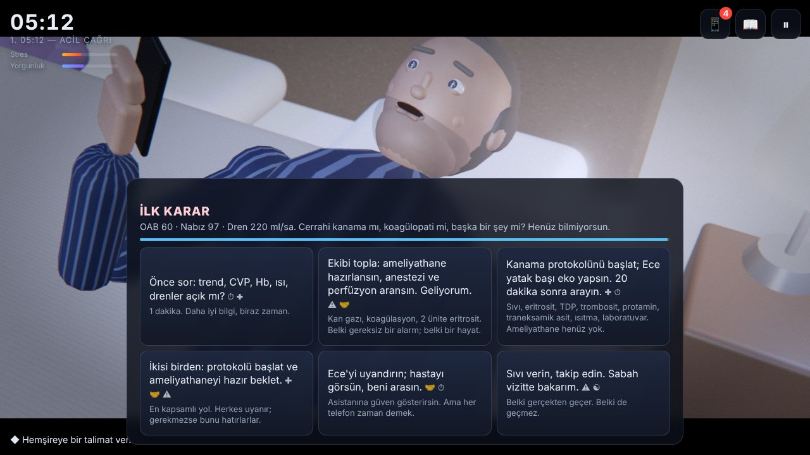
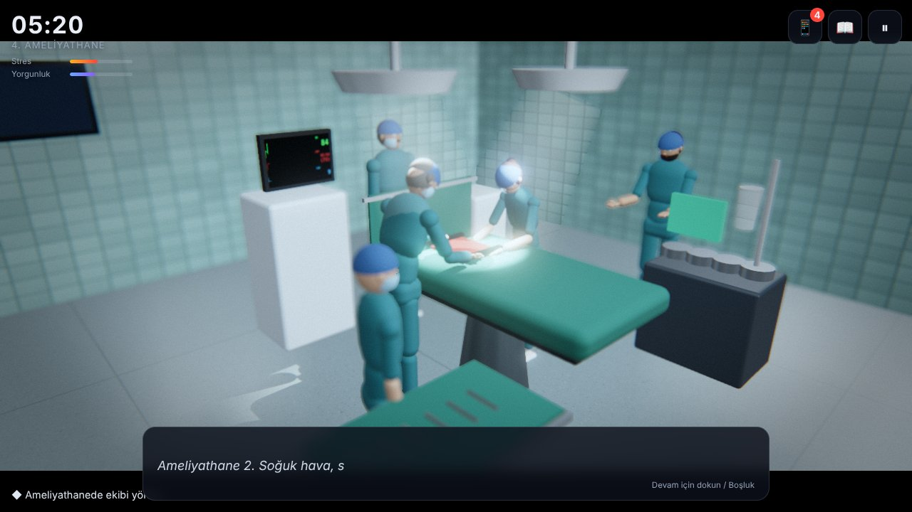
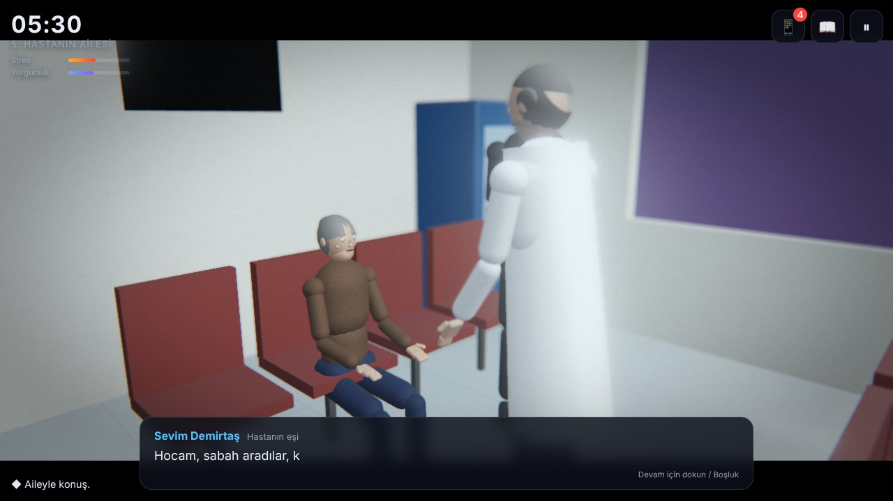
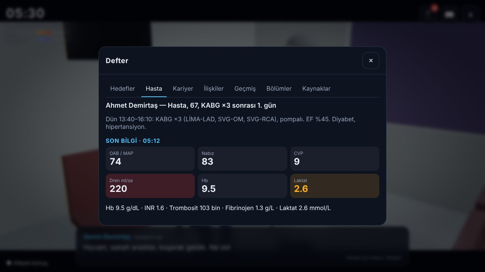
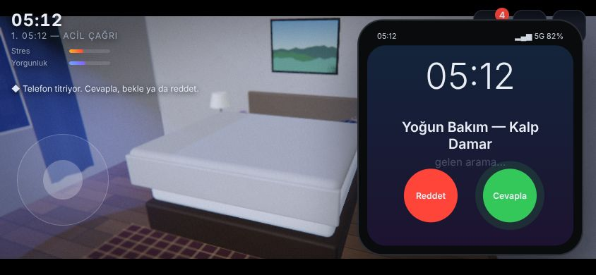

# HEARTLINE: The Life of a Cardiac Surgeon

*HEARTLINE: Bir Kalp Cerrahının Hayatı* — a narrative 3D game. You play Dr. Kemal Arslan, a
50-year-old cardiac surgeon in Bursa, Türkiye. At **05:12** his phone vibrates: the ICU reports that
yesterday's bypass patient is bleeding. What you do next, at the bedside, at home and in front of
the patient's family, shapes the patient's course, your team, your family and, weeks later, your
career.

> **Fiction, not advice.** The people, the hospital and the events are invented. The medical model
> is simplified for gameplay and has **not** been reviewed by clinicians. The legal process is a
> simplified fictional model and is **not legal advice**. See [docs/RESEARCH.md](docs/RESEARCH.md).

| 05:12 — the phone rings | The first decision | The operating room |
| --- | --- | --- |
|  |  |  |
| **The patient's family** | **Patient journal** | **Phone-sized touch layout** |
|  |  |  |

*Screenshots: Balanced preset (the default on phones), captured in a GPU-less container with software WebGL (SwiftShader).*

## Contents

- [Running the game](#running-the-game)
- [Controls](#controls)
- [What is in this version](#what-is-in-this-version-v010)
- [Engine choice and platforms](#engine-choice-and-platforms)
- [Assets](#assets)
- [Tests](#tests)
- [Building and deploying](#building-and-deploying)
- [Known limitations](#known-limitations)
- [Project layout](#project-layout) · [Architecture](docs/ARCHITECTURE.md) · [Research](docs/RESEARCH.md)

## Running the game

Requires **Node.js 18+** (developed with Node 22) and a browser with WebGL 2 (current Chrome, Edge,
Safari, Firefox).

```bash
cd heartline
npm install
npm run dev          # http://localhost:5173
```

The repository's GitHub Pages workflow also builds the game and publishes it under
`https://<user>.github.io/<repo>/heartline/`. On iPhone/Android open that address and use
*Share → Add to Home Screen* (iOS) or *Install app* (Android) to launch it full-screen.

## Controls

| Desktop | Touch | Action |
| --- | --- | --- |
| **W A S D** / arrows | left joystick | Walk (camera-relative) |
| **Shift** | push the stick to the edge | Hurry (not possible when exhausted) |
| drag with the mouse, wheel | drag the right half of the screen | Orbit / zoom the camera |
| **E** or **F** | ✋ button / tap the prompt | Interact |
| **Space** / **Enter** / click | tap the dialogue box | Continue dialogue |
| click a card | tap a card | Choose |
| **P** / **Tab** | 📱 | Phone: messages, contacts, calls |
| **J** | 📖 | Journal: objectives, patient, career, relationships, history, chapters, sources |
| **Esc** | ⏸ | Pause: save, load, settings, main menu |

Touch targets are at least 44 px; text size, text speed, camera sensitivity, inverted look and
reduced motion are in **Settings**.

## What is in this version (v0.1.0)

A complete, playable day with branching and multiple endings. All eight chapters exist; chapters
1–5 are fully staged, chapters 6–8 are compact.

1. **05:12 — The Emergency Call.** A dark bedroom; the phone buzzes on the nightstand. **Answer**,
   **wait** (it rings out after ~20 s and calls again; after two missed calls the nurse escalates
   to the resident) or **decline**. The camera closes in, the lamp comes on, his expression changes.
2. **The First Decision.** A timed decision card (stress shortens timers): ask for details, mobilise
   the OR, start a bleeding protocol, both, delegate to the resident, or dismiss the concern. A
   read-back step follows. Then get ready at home: get out of bed, wash, dress, coffee, breakfast,
   messages, talk with Ayla, leave — **every action costs in-game minutes while the patient's
   physiology keeps running.** Going back to sleep is possible.
3. **Arrival at the Hospital.** A simplified commute (drive fast or safely, hands-free calls, a
   timed junction event), then walk through the hospital to the ICU. The **first major decision**
   at the bedside: echo, drains, labs, ask the resident, then re-explore / continue medical
   management / open at the bedside.
4. **The Operating Room.** Time-out, pump priming, cell saver, the finding (depends on the hidden
   cause), a systematic check that **fatigue can lock**, an unexpected **VF** event with a timer,
   closure, operative note, handover.
5. **The Patient's Family.** Disclosure (honest / technical / blaming the team / minimising),
   apology, access to records.
6. **The Night Shift** (compact). Deniz's concert vs staying, the unwritten note, a 02:10 call.
7. **The Complaint** and 8. **The Consequences** (compact). Three weeks later: the outcome, a
   possible complaint, internal review, compensation claim, criminal complaint with the
   investigation-permission stage — all **driven by recorded evidence** — and the ending.

**Endings:** Professional Success · A Balanced Life · The Empty Chair (family difficulties) ·
After the Crisis (recovery after a professional crisis) · A Dispute Resolved · A Heavy Price
(serious career consequences).

### Systems

- **Hidden clinical truth** (surgical bleeding, coagulopathy, or tamponade, where falling drain
  output looks like improvement) chosen per new game. A minute-by-minute patient model
  (`src/medical/Patient.ts`) responds to every order and every minute spent.
- **Player state** with mechanical effects: stress (shorter decision timers, heartbeat, vignette,
  camera shake), fatigue (locks demanding choices, slows walking, prevents hurrying), reputation,
  team trust (unlocks hand-off options), family, finances, documentation (how clearly a later
  review can establish facts), career.
- **Consequences** immediate, later the same day, days later (late fee) and weeks later (review).
  Characters **remember** interactions (`memories`) and greet you differently.
- **Outcome ≠ negligence.** `src/legal/LegalSystem.ts` separates the patient's outcome, recorded
  deviations, causation and documentation clarity. A bad outcome with good care never produces
  fault or prosecution; criminal proceedings require serious, causal deviations and pass through
  an investigation-permission stage. Nobody is ever sentenced in the game.
- **Phone** with messages (some need replies), contacts and calls; **journal** with objectives,
  the patient's last report, career stats (each with its mechanical effect), relationships with
  memories, event history, chapters and sources.
- **Saving:** autosave at checkpoints (after the first decision, at each scene change, at the
  ending) + 3 manual slots, *Continue* after closing the browser. Saved: chapter and scene,
  player state, patient state (including hidden physiology), relationships and memories,
  decisions, completed events, pending consequences, position. Settings are saved separately.
- **Turkish and English** throughout (all Turkish characters supported), switchable any time.

## Engine choice and platforms

The development environment was inspected first (Linux container, 4 CPUs, no GPU; Node 22,
Python 3, Playwright Chromium; **no Unreal Engine, Unity or Godot installed**). Installing UE5 or
Unity here was not practical (size, licensing, no GPU, no display) and no build of either could
have been produced or tested. The repository already contained a Three.js + TypeScript + Vite game
(`shadow_warriors/`), so the same stack was chosen:

- **Three.js 0.186 + TypeScript 5.9 + Vite 7**, Vitest for unit tests, Playwright for browser tests.
- One codebase runs on **Windows, macOS, iPhone and Android** in the browser and as an installable
  web app (manifest included).

| Platform | Status |
| --- | --- |
| Windows / macOS / Linux browser | Runs; tested in headless Chromium (Linux) |
| iPhone / iPad (Safari) | Responsive touch UI, tested only with Chromium's mobile emulation — **not tested on a real iOS device** |
| Android (Chrome) | Same as above — **not tested on a real device** |
| Native installers (.exe/.app/.ipa/.apk) | **Not built.** The architecture is compatible with wrapping (Capacitor for iOS/Android, Tauri/Electron for desktop) but no native build was made or tested. |

## Assets

**No external models, textures, sounds or fonts are used.** Everything is generated at runtime:

- Characters: a procedural rig built from primitives, with a face rig (eyelids, blinking, brows,
  mouth corners, jaw, cheeks, forehead lines, gaze), 11 expressions, walking/idle/sitting/lying/
  phone/washing/drinking/surgical/driving poses, talking mouth and head turns.
- Environments: apartment (bedroom, bathroom, hallway, kitchen-living), car and dawn road with
  Uludağ, hospital exterior/lobby/corridor/ICU/waiting room, operating theatre, office.
- Textures: canvas-generated wood, tiles, fabric, marble, linoleum, facades, signage, sky.
- Screens: a live bedside monitor (ECG, arterial line, CVP drawn from the patient model), phone,
  car display, wall clock.
- Sound: Web Audio synthesis — room tones, phone vibration, ICU monitor beeps locked to the
  simulated heart rate, pressure alarms, heartbeat under stress, footsteps, car, OR.
- Voices: optional device text-to-speech (Settings → *Spoken dialogue*). Quality depends on the
  voices installed on the device; there is no recorded voice acting.

This keeps the project free of licensing questions, but it is **stylised, not photorealistic**.

**Cinematic rendering** (Balanced and Quality presets): letterbox bars in dialogue and cutscenes,
depth of field in close-ups, slow camera push-ins, per-location colour grading (night blue at
home, cold theatre, warm office), depth haze, moonlight and surgical-lamp light beams, multisampled
anti-aliasing with post-processing, bloom, and ambient occlusion on Quality. Phones (e.g. iPhone 16)
default to Balanced.

## Tests

```bash
npm test                      # unit tests (Vitest, no browser) — 33 tests
npm run typecheck
npm run dev &                 # then, in another shell:
npm run e2e                   # main playthrough in headless Chromium (21 checks)
node scripts/e2e-alt.mjs      # a second branch (decline the call, call back, mislead the family…)
node scripts/shots.mjs        # regenerate the screenshots in docs/
```

Results from the last run in the development container:

- `npm test`: **33/33 passed** (patient model, balance, conditions, consequences, memories,
  narrative graph integrity and bilingual completeness, legal principles, save round-trip,
  corrupt-save rejection, branch scenarios).
- `npm run e2e` (hidden cause fixed to surgical bleeding with `?truth=surgical`): **21/21 checks
  passed** — start, the ringing phone, answering, decision cards, choices changing state, WASD
  movement, getting ready, manual save → page reload → *Continue*, leaving home, the commute,
  reaching the hospital, the first major decision, the OR sequence, the family, an ending, the
  history log, switching to English, no console errors.
- `scripts/e2e-alt.mjs` (`?truth=tamponade`, English UI): **9/9 checks passed** — declining,
  calling back from the contact list, a rushed read-back recorded as a deviation, the pyjama
  check at the door, the timed junction card, a different ending (*A Dispute Resolved*). In that
  run the resident's call-back had not arrived before leaving home, so that call was not exercised
  in the browser (it is covered by unit tests).

`?seed=<n>` and `?truth=surgical|coagulopathy|tamponade` make a run reproducible (testing aids).

The browser tests use software WebGL; they verify behaviour, not frame rate.

## Building and deploying

```bash
npm run build      # typecheck + production build into dist/ (relative paths, works from a sub-folder)
npm run preview    # serve dist/ locally
```

`.github/workflows/pages.yml` (repository root) runs the unit tests, builds the game and publishes
it to GitHub Pages under `/heartline/`.

## Known limitations

- **Graphics** are procedural and stylised; no photoreal characters, motion capture, lip-sync or
  facial capture. A real GPU is needed for the *Quality* preset; *Performance* uses cheaper
  materials and no shadows for phones.
- Performance was measured only with software rendering (about 3 fps at 1024×576 on *Performance*
  in the container); real-device frame rates are **unmeasured**.
- **Chapters 6–8** are compact text-and-choice scenes (with staging), not fully explorable levels.
- The **medical model** is a gameplay approximation, not a validated simulator. Thresholds and
  rates must be reviewed by cardiac surgeons and intensivists before any claim of accuracy.
- The **legal model** is simplified fiction based on secondary sources; full texts of legislation
  and court decisions could not be fetched from this environment (see docs/RESEARCH.md).
- There is no offline service worker; the installed web app needs the network for the first load.
- Accessibility: text scaling, reduced motion and a light-independent UI are provided; full
  screen-reader support of the 3D scenes is not.

## Project layout

```
heartline/
  index.html, public/          entry page, manifest, icon
  src/main.ts                  bootstrap
  src/game/       Game.ts      main loop, scenes, phone, movement, saving
                  Story.ts     chapter/scene progression, delay evaluation, legal review, ending
  src/narrative/  Engine.ts    data-driven dialogue engine; content/*.ts = all story data
  src/state/                   GameState (stats, flags, memories, consequences), Save, types
  src/medical/                 Patient.ts (physiology), research.ts (sources shown in-game)
  src/legal/                   LegalSystem.ts (fault, causation, clarity, stages, endings)
  src/characters/              Character.ts (rig, face, animation), cast.ts
  src/world/                   Areas: Home, Car, Hospital, OR/Office; kit + procedural textures
  src/render/                  Renderer (presets, grading), CameraRig, live Screens
  src/audio/                   procedural Audio, optional Voice (TTS)
  src/ui/                      menus, HUD, dialogue/cards, phone, journal, settings, touch
  src/i18n/strings.ts          interface strings (TR/EN)
  tests/                       Vitest unit tests
  scripts/                     Playwright browser tests and screenshot script
  docs/                        ARCHITECTURE.md, RESEARCH.md, screenshots
```

---

### Türkçe özet

**HEARTLINE**, Bursa'da yaşayan 50 yaşındaki kalp cerrahı Dr. Kemal Arslan'ın gününü anlatan 3B
anlatı oyunudur. Saat 05:12'de yoğun bakımdan gelen telefonla başlar; telefondaki talimatlarınız,
evde geçirdiğiniz her dakika, yatak başındaki ve ameliyathanedeki kararlarınız, aileyle
konuşmanız hastanın seyrini, ekibinizi, ailenizi ve haftalar sonraki inceleme sürecini belirler.
Kötü sonuç tek başına kusur sayılmaz: süreç kayıtlı sapmalara, illiyet bağına ve kayıtların
açıklığına göre işler. Çalıştırmak için: `cd heartline && npm install && npm run dev`.
Kurgusaldır; tıbbi ve hukuki içerik eğitim amaçlı sadeleştirilmiştir ve klinisyen/hukukçu
denetiminden geçmemiştir.
