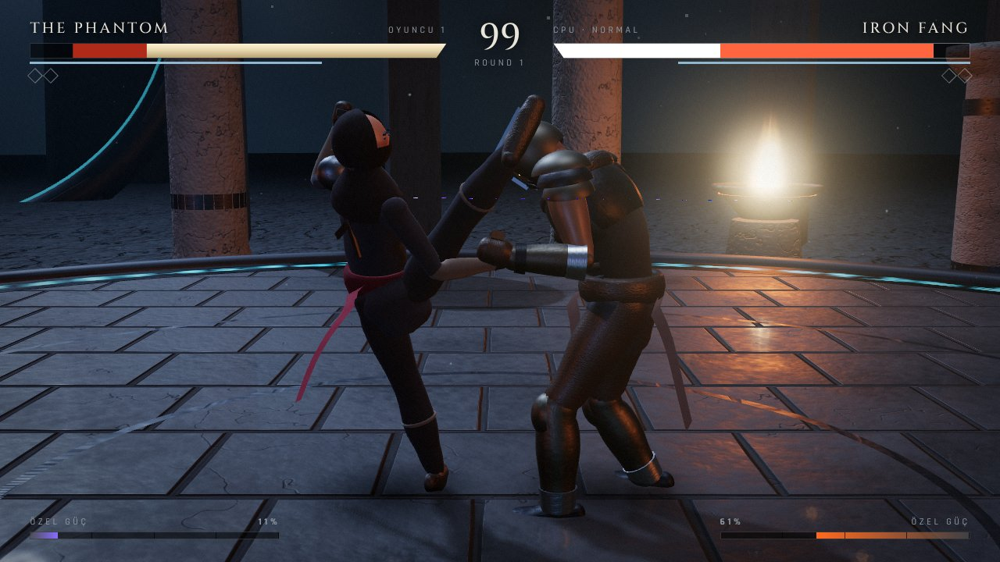
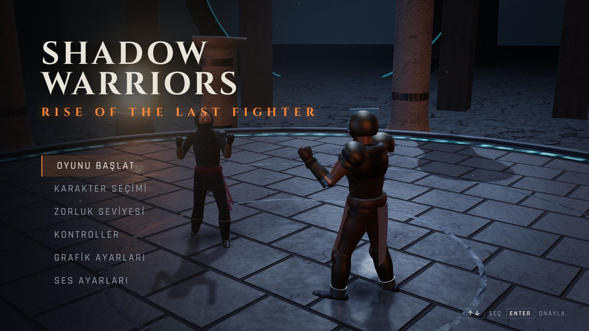
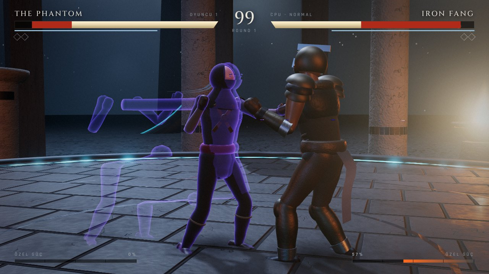

# SHADOW WARRIORS: RISE OF THE LAST FIGHTER

Masaüstü tarayıcıda çalışan, gerçek zamanlı 3D dövüş oyunu. Three.js + TypeScript + Vite ile yazıldı.
Terk edilmiş fütüristik bir tapınakta iki dövüşçü: çevik **The Phantom** ve zırhlı dev **Iron Fang**.



| Ana menü | Phantom Rush (özel saldırı) |
| --- | --- |
|  |  |

*Görüntüler GPU'suz test ortamında yazılım tabanlı WebGL ile "Yüksek" ayarda alınmıştır.*

## Çalıştırma

Node.js 18+ gerekir.

```bash
cd shadow_warriors
npm install
npm run dev        # http://localhost:5173 adresinde geliştirme sunucusu
```

Diğer komutlar:

```bash
npm run build      # tip kontrolü + üretim derlemesi (dist/)
npm run preview    # derlenmiş sürümü yerelde sunar
npm test           # savaş sistemi ve yapay zekâ testleri (Vitest, tarayıcısız)
npm run e2e        # uçtan uca tarayıcı testi (Playwright; önce `npm run dev` açık olmalı)
```

Depo GitHub Pages'te yayınlanırken bu klasör otomatik derlenir ve `…/shadow_warriors/` adresinden açılır.

## Kontroller

| Tuş | Eylem |
| --- | --- |
| **A / D** | Ekrana göre sola / sağa (rakibe doğru = ileri, rakipten uzak = geri) |
| **W / S** | Derinlikte yana adım (rakibin etrafında dönme) |
| **J** | Hafif yumruk |
| **K** | Güçlü yumruk |
| **U** | Hafif tekme |
| **I** | Güçlü tekme |
| **L** (basılı) | Blok |
| **Space** | Kaçınma (tek başına veya W/S ile yana kaçış); ileri + Space **hamle**, geri + Space **geri sıçrama** |
| **O** | Özel saldırı (özel güç çubuğu doluyken) |
| **Esc** | Duraklatma menüsü |
| **F3** | Hitbox / hurtbox gösterimi (hata ayıklama) |

Tüm tuşlar **Kontroller** menüsünden değiştirilebilir. Oyun kumandası (standart eşleme) desteklenir:
sol çubuk / D-pad hareket, X/Y yumruk, A/B tekme, RB blok, LB kaçınma, RT özel, Start duraklat.
Menülerde ok tuşları / Enter / Esc veya fare kullanılabilir.

### Kombolar

Zincirler yalnızca önceki vuruş **isabet ettiğinde veya bloklandığında** ve iptal penceresi içindeyken devam eder.

| Dövüşçü | Kombo | Tuşlar |
| --- | --- | --- |
| The Phantom | Shadow Chain | J → J → U → O |
| The Phantom | Nightfall | J → J → U → I |
| The Phantom | Ghost Palm | J → J → K |
| Iron Fang | Iron Avalanche | J → J → K |
| Iron Fang | Fang Crusher | J → U → I |
| Iron Fang | Temple Fall | J → J → I |

İsimli bir kombo tamamlanınca son vuruş %15 bonus hasar verir.

## Kendi karakterin ("SEN")

Ana menü → **Karakterini Oluştur**:

1. **Fotoğraf seç:** tercihen yüzünün ve kıyafetinin göründüğü, iyi ışıklı tam boy bir fotoğraf.
2. **Yüz çerçevesi:** fotoğrafta yüzüne tıkla/sürükle, boyutu kaydırıcı veya fare tekerleğiyle ayarla.
   Yüz, 3D karakterin kafasına giydirilir.
3. **Renkler:** Ten / Saç / Üst / Alt / Ayakkabı düğmesini seçip fotoğrafta o yere tıkla
   (ya da düğmedeki renk kutusundan elle seç).
4. **Boy, yapı, saç, kol boyu ve dövüş stili** (Hızlı = Phantom hareketleri, Güçlü = Iron Fang hareketleri).
5. **Kaydet:** karakter seçiminde "SEN" (isminle) olarak çıkar; HUD'da adın görünür.

Fotoğraf ve karakter yalnızca **o bilgisayardaki tarayıcıda** (localStorage) saklanır; GitHub'a veya
başka bir sunucuya gönderilmez. Başka bir bilgisayarda/tarayıcıda yeniden oluşturmak gerekir. "Sil" ile kaldırılır.

**Sınır:** tek fotoğraftan gerçek 3D vücut taraması yapılmaz. Vücut, seçtiğin boy/yapı ve fotoğraftan alınan
renklerle şekillenen genel bir modeldir; yüz düz bir fotoğraf olarak kafaya giydirilir (yandan bakınca düzleşir).

### 3D tarama ile (gerçek vücudun)

Bir 3D tarayıcınız varsa vücudunuzu doğrudan oyuna alabilirsiniz. **Karakterini Oluştur → 3D tarama yükle**:

- **Desteklenen biçimler:** GLB/GLTF, OBJ (+ MTL + doku resimlerini **birlikte seçin**), PLY (renkli nokta/köşe
  renkleri dahil), STL (renksiz), FBX. Draco ile sıkıştırılmış GLB desteklenmez; sıkıştırmasız dışa aktarın.
- **Nasıl taranmalı:** ayakta, kollar gövdeden biraz açık (**A-poz** veya **T-poz**), bacaklar hafif ayrık, tek parça
  ve kapalı (su geçirmez) bir model en iyi sonucu verir. Taban/zemin parçası varsa tarama yazılımında silin.
- **Otomatik işlemler:** yukarı ekseni (Y veya Z) ve yönü bulur, ayakları zemine oturtur, birimi (m / cm / mm)
  anlayıp **gerçek boyu** karaktere uygular, modeli ~40 bin üçgene sadeleştirir, iskeleti kol/bacak yönlerine göre
  oturtur ve her noktayı en yakın kemiklere bağlar. Sonra tüm dövüş animasyonları taramanızla oynar.
- Model yüzü bize dönük değilse **180° çevir**, yatık geldiyse **Yatır / kaldır** düğmesini kullanın.
- Tarama, tarayıcının yerel veritabanında (IndexedDB) saklanır; hiçbir sunucuya gönderilmez.

**Sınırlar:** iskelet ve ağırlıklar otomatiktir; profesyonel elle rig kalitesinde değildir. Kolların gövdeye
değdiği taramalarda (kollar yanda) koltuk altı bölgesi bozulabilir. Taramadaki açık eller oyunda yumruk olmaz,
açık el olarak kalır. Yüz ifadesi canlandırılmaz.

## Teknoloji ve mimari

| Katman | Seçim | Not |
| --- | --- | --- |
| Grafik | Three.js r186 (WebGL 2) | PBR malzemeler, PCF gölgeler, PMREM ortam haritası |
| Dil / derleme | TypeScript (strict) + Vite 7 | |
| Post-processing | EffectComposer: MSAA, UnrealBloom, ACES ton eşleme, özel renk düzenleme geçişi | |
| Fizik | Özel deterministik 60 Hz simülasyon | Bkz. aşağıdaki not |
| Ses | Web Audio API | Tüm sesler gerçek zamanlı sentezlenir |
| 3D tarama | three.js yükleyicileri + meshoptimizer | Sadeleştirme, IndexedDB'de saklama |
| Test | Vitest (savaş/YZ), Playwright (uçtan uca) | |

**Neden Rapier değil?** 1'e 1 dövüş oyununda kare (frame) hassasiyetinde, deterministik ve tekrarlanabilir
bir sistem gerekir: vuruş pencereleri, iptal pencereleri, hit-stop ve itme kutuları. Genel amaçlı bir rijit
cisim motoru bu kurallarla çakışır ve gereksiz yük getirir. Bu yüzden itme kutusu (pushbox) çarpışması,
arena sınırı, savrulma ve düşme yayları özel, sabit adımlı (60 Hz) bir simülasyonla çözülür; görüntü
katmanı bu simülasyonu enterpolasyonla her ekran yenileme hızında akıcı çizer.

### Dosya yapısı

```
shadow_warriors/
├── index.html                 Oyun sayfası
├── lab.html                   Geliştirici poz/model inceleme sahnesi (derlemeye girmez)
├── src/
│   ├── main.ts                Giriş noktası
│   ├── styles.css             Menü ve HUD stilleri
│   ├── game/Game.ts           Oyun akışı, sabit adımlı döngü, olay → efekt/ses/kamera yönlendirme
│   ├── combat/
│   │   ├── types.ts           Saldırı, durum ve olay tipleri
│   │   ├── data.ts            Karakter ve hareket verileri (frame data, hitbox, kombolar)
│   │   ├── Fighter.ts         Dövüşçü durum makinesi (combat state machine)
│   │   └── Match.ts           Raund akışı, hitbox/hurtbox, blok, kombo, hasar, itme kutuları
│   ├── ai/AIController.ts     Durum makineli yapay zekâ, 3 zorluk profili
│   ├── characters/
│   │   ├── Rig.ts             Prosedürel iskelet ve skinned gövde üretici
│   │   ├── appearance.ts      The Phantom, Iron Fang ve kendi karakterin (fotoğraflı) görünümleri
│   │   ├── profile.ts         Kendi karakter profili: fotoğraf, yüz kırpma, renk örnekleme, kayıt
│   │   ├── scan.ts            3D tarama içe aktarma: okuma, yön/ölçek, sadeleştirme, IndexedDB
│   │   ├── scanRig.ts         Taramaya otomatik iskelet oturtma ve ağırlıklandırma
│   │   ├── Pose.ts            Poz karıştırma ve iki kemikli bacak IK (ayak kayması önleme)
│   │   ├── clips.ts           Elle anahtarlanmış animasyon klipleri
│   │   ├── Animator.ts        Durum → klip seçimi, geçişler, adım uzunluğu eşlemeli yürüme
│   │   ├── Ribbon.ts          Verlet kumaş şeritleri (kuşak, başlık, tabard)
│   │   └── FighterView.ts     Model + animasyon + temas gölgesi + iz/enerji efektleri
│   ├── world/Arena.ts         Tapınak arenası, ışıklar, sis, gökyüzü, mangallar, ışık huzmeleri
│   ├── render/
│   │   ├── Renderer.ts        WebGL renderer, post-processing, düzlemsel zemin yansıması
│   │   ├── CameraRig.ts       Dövüş kamerası, sarsıntı, sinematik geçişler
│   │   ├── Particles.ts       Havuzlanmış GPU parçacıkları, şok dalgaları
│   │   └── textures.ts        Prosedürel PBR dokular (taş, metal, kumaş, deri, cilt)
│   ├── audio/Audio.ts         Prosedürel ses efektleri, ambiyans, müzik nabzı
│   ├── ui/UI.ts               Menüler, ayarlar, karakter seçimi, HUD, anons, sonuç ekranı
│   ├── ui/Creator.ts          Karakter oluşturucu ekranı
│   └── core/                  Girdi (klavye/kumanda, tuş atama), ayarlar, matematik
├── tests/combat.test.ts       Savaş sistemi ve YZ testleri
└── scripts/                   Uçtan uca test ve ekran görüntüsü araçları
```

## Tamamlanan özellikler

- **Oyun akışı:** yükleme ekranı → ana menü → karakter seçimi → zorluk → giriş animasyonları
  (Enter ile geçilebilir) → "ROUND n / FIGHT!" → dövüş → K.O. / süre doldu → zafer pozu → sonuç ekranı
  (tekrar oyna / karakter seçimi / ana menü). 3 raunttan 2'sini alan kazanır, raund süresi 99 sn.
- **Dövüş sistemi:** her saldırının başlangıç, aktif ve toparlanma kareleri, hasarı, blok hasarı,
  sersemletme süreleri, menzili (fighter-local hitbox küresi, bazıları süpürür) ve itme kuvveti var.
  Hurtbox'lar bacak/gövde/kafa kapsülleri. Bir saldırı yalnızca aktif karelerinde ve tek sefer isabet eder.
- **Savunma:** blok (yalnızca önden; hasarı %12–20'ye düşürür, blok sersemletmesi, guard göstergesi;
  guard biterse **GUARD BREAK**), yana kaçış (yenilmezlik kareleri), geri sıçrama, ileri hamle (saldırıyla iptal edilebilir).
- **Durumlar:** sersemleme, ağır karşı vuruşta **sendeleme**, **arkadan vuruş** (+%25, bloklanamaz),
  **counter** (+%20), Iron Fang'in Haymaker ve özel saldırısında **zırh** (darbe yer ama kesilmez),
  savrulup düşme, yerde kalma, yenilmez kalkış.
- **Kombo:** girdi tamponu (8 kare, hit-stop sırasında da), iptal pencereleri, kombo sayacı ve hasar
  ölçekleme (3. vuruştan itibaren azalan), isimli kombo bonusu, özel güç çubuğu (vurarak / hasar alarak dolar).
- **Özel saldırılar:** *Phantom Rush* (yenilmez giriş, 4 vuruşlu seri, yere seren son vuruş, art arda
  görüntü izleri) ve *Fang Breaker* (zırhlı sıçrama, yere yumruk, alan şok dalgası).
- **Vuruş hissi:** hit-stop, travma tabanlı kamera sarsıntısı, darbe yönünde geri tepme ve gövde
  irkilmesi, kıvılcım/toz/enerji parçacıkları, darbe parlaması, K.O. ve özel saldırılarda ölçülü ağır çekim.
- **Yapay zekâ:** gecikmeli algı (tepki süresi), mesafe yönetimi, menzile girme, blok/kaçınma,
  boşa giden veya bloklanan saldırıları cezalandırma, isabet sonrası kombo devam ettirme, düşük canda
  temkinli davranma, son kullanılan saldırıları tekrar etmeme, oyuncunun saldırganlık/blok/kaçınma
  alışkanlıklarına göre strateji değiştirme. Kolay / Normal / Zor; can artırılmaz — tepki süresi,
  karar sıklığı, blok/kaçınma/kombo/cezalandırma olasılıkları ve hata oranı değişir.
- **Karakterler:** prosedürel iskelet (19 kemik) ve yumuşak ağırlıklı skinned gövde, PBR kumaş/deri/metal/cilt,
  zırh parçaları, Verlet kumaş şeritleri, enerji kenar parlaması, ayna maçlarında alternatif kostüm.
- **Animasyonlar:** idle (nefes), yürüme (ileri/geri/yana, adım uzunluğu gerçek hıza eşlenir, ayaklar IK ile
  yere basar), hamle, geri sıçrama, yana kaçış, her saldırı için ayrı klip, blok, blok sarsıntısı, üç farklı
  darbe alma, sendeleme, guard break, savrulma, yerde yatma, kalkış, iki karaktere özel giriş ve zafer pozları,
  yenilgi (diz çökme), K.O.
- **Arena:** taş döşemeli dairesel platform (prosedürel PBR, zeminde düzlemsel yansıma), rün kazınmış
  metal sınır halkası, basamaklar, yivli sütunlar (instanced), yıkık kemerler, uzak kuleler, dev hale kapılar,
  dört alevli mangal (titreyen nokta ışıklar), ay ışığı gölgeleri, hacimsel ışık huzmeleri, üstel sis,
  bulutlu yıldızlı gökyüzü, uzakta süzülen fenerler, toz zerreleri.
- **Kamera:** iki dövüşçüyü yandan kadrajlar, mesafeye göre geri çekilir, aynı tarafta kalır (ani dönüş yok),
  arena halkasının dışına çıkmaz, sarsıntı ve özel saldırı / giriş / K.O. / zafer sinematikleri.
- **Arayüz:** animasyonlu ana menü, karakter seçimi (istatistikler), zorluk, kontroller (tuş atama + hareket listesi),
  grafik ayarları (kalite ön ayarı, çözünürlük ölçeği, gölge, bloom, yansıma, parçacık, kamera sarsıntısı,
  FPS göstergesi), ses ayarları, duraklatma menüsü. HUD: can barları (gecikmeli hasar barı), guard göstergesi,
  özel güç çubukları, raund göstergeleri, süre, kombo sayacı, COUNTER/BACK HIT/ARMOR yazıları, anonslar.
- **Ses:** yumruk/tekme/darbe/blok (zırhlıda metalik), savuruş, ayak sesi, yere düşme, özel saldırı,
  şok dalgası, menü sesleri, raund gongu, FIGHT ve K.O. vurgusu, rüzgâr + uğultu + ateş çıtırtısı ambiyansı,
  can azaldıkça yoğunlaşan davul nabzı, tapınak yankısı. Her çalışta ton/filtre rastgele değişir.
- **Performans:** sabit adımlı simülasyon + enterpolasyon, havuzlanmış parçacıklar (çalışma sırasında bellek
  tahsisi yok), instancing, aksesuar mesh birleştirme, yarı çözünürlüklü bloom ve yansıma, kalite ön ayarları.

## Bilinen eksiklikler ve dürüst notlar

- **Karakter modelleri ve animasyonlar prosedüreldir.** Proje hiçbir harici 3D model, motion-capture veya
  ses dosyası içermez. Karakterler kodla şekillendirilmiş skinned mesh'lerdir; animasyonlar elle anahtarlanmış
  klipler + IK + prosedürel katmanlardır. Okunaklı ve tutarlı görünürler ancak **profesyonel olarak modellenmiş
  ve motion-capture ile canlandırılmış AAA karakterlerin kalitesinde değildir** (yüz detayı, kas deformasyonu,
  kumaş simülasyonu sınırlıdır).
  *Yükseltme önerisi:* lisansı uygun rigged GLB karakterler (ör. Mixamo hesabıyla dışa aktarılan karakter +
  animasyonlar veya CC0 paketler) `GLTFLoader` ile yüklenip `Animator`'ın klip seçimine bağlanabilir;
  savaş simülasyonu modelden bağımsız olduğu için oynanış değişmez.
- **Sesler sentezlenmiş geçici efektlerdir**, kayıtlı foley değildir. Lisanslı ses paketiyle değiştirilmesi önerilir.
  Anons sesi (spiker) yoktur; anonslar yazılıdır.
- Yalnızca tek oyunculu (CPU'ya karşı) mod vardır; yerel 2 oyunculu veya çevrimiçi mod yoktur. Tek arena vardır.
- Yalnızca 2 karakter vardır; alçak/yüksek saldırı ayrımı ve fırlatma (throw) yoktur.
- Kumanda desteği standart eşlemeli kumandalara göre yazıldı; gerçek bir kumandayla test edilmedi.
- Ortam: test makinesinde GPU yoktu. Oyun yazılım tabanlı WebGL (SwiftShader) ile çalıştırılarak test edildi;
  bu ortamda kare hızı anlamlı değildir (~5 FPS). **1080p/60 FPS hedefi gerçek bir GPU'da ölçülmedi.**
  Yüksek ayarda kare başına ~300 çizim çağrısı ve ~280 bin üçgen ölçüldü; orta seviye bir masaüstü ekran kartı
  için makul bir bütçedir. Düşük performansta Grafik Ayarları → Kalite "Orta/Düşük" önerilir.
- Grafik kalitesi değişince doku çözünürlüğü yalnızca sayfa yeniden yüklendiğinde değişir.
- Yazı tipleri Google Fonts'tan yüklenir; çevrimdışıyken sistem yazı tiplerine düşer.
